# EduGrowth

EduGrowth is an end-to-end student-performance platform made of **three**
independently runnable services:

| Part | Tech | Purpose | Local URL |
|------|------|---------|-----------|
| [`frontend/`](frontend) | React 19 + Vite + Tailwind 4 | Student & faculty dashboards, login, password reset | https://edu-growth-frontend.onrender.com/ |
| [`backend/`](backend) | Express 5 + MongoDB + JWT | Authentication (students & faculty), password reset, logout | https://edu-growth-auth.onrender.com/ |
| [`ML/`](ML/README.md) | FastAPI + XGBoost/KMeans on PostgreSQL (Neon) | CGPA prediction, at-risk detection, mentor assignment, student CRUD | https://edu-growth-api.onrender.com/docs#/
|

The frontend calls **both** backends: authentication goes to the Express service
(`VITE_AUTH_BASE_URL`) and analytics goes to the FastAPI service
(`VITE_API_BASE_URL`). The analytics API is public; only auth is token-protected.

## Quick start

Run the three services in three terminals.

**1 · Analytics API (`ML/`)**

```bash
cd ML
python -m pip install -r requirements.txt   # or: poetry install
cp .env.example .env                        # set DATABASE_URL (Neon Postgres)
python -m uvicorn app.main:app --host 127.0.0.1 --port 8000
```

**2 · Auth service (`backend/`)**

```bash
cd backend
npm install
cp .env.example .env                        # set MONGO_URI + JWT_SECRET
npm run dev                                 # listens on 5001 by default
```

**3 · Frontend (`frontend/`)**

```bash
cd frontend
npm install
cp .env.example .env                        # VITE_API_BASE_URL + VITE_AUTH_BASE_URL
npm run dev                                 # http://localhost:5173
```

> No MongoDB handy? The frontend ships a zero-dependency auth **mock** that
> mirrors the real backend contract: `npm run auth:mock` (from `frontend/`).

## Authentication at a glance

- **Students** identify themselves by 12-digit roll number (or email).
  - Self-registered students log in with the password they chose (bcrypt-hashed).
  - Roster students imported from the roll-number list have no stored password;
    their password is derived by the backend as `<full name>@123`
    (e.g. `Aarav Rao@123`).
  - Roster students whose name is blank or `Unknown` in the source data are
    imported with the **roll number as the name**, so their password is
    `<roll_no>@123` (e.g. `210029013131@123`).
- **Faculty** log in with `email` + password. The seeded admin account is
  `faculty@college.edu` / `teacher123` (change it for any real deployment). The
  Faculty dashboard reads the **whole roster from the analytics API**, so one
  teacher login can see every student.
- **Password reset** emails a `FRONTEND_URL/reset-password?token=...` link; the
  frontend `ResetPassword` page consumes the token. Roster students without an
  email on file get a generic response (nothing to send to).
- Logout revokes the JWT server-side (`RevokedToken` collection).

### Roster sync (Neon → MongoDB)

The analytics service reads the authoritative roster from Neon; the auth service
authenticates against MongoDB. To copy every Neon student into MongoDB (so they
can log in), run:

```bash
# 1. Neon -> CSV   (reads DATABASE_URL from ML/.env)
cd ML
python -m scripts.export_roster_csv roster.csv

# 2. CSV -> MongoDB (reads MONGO_URI from backend/.env) — insert-only, idempotent
cd ../backend
node scripts/importStudents.js ../ML/roster.csv --apply --unknown-as-roll
```

## What is where

| Path | What |
|------|------|
| [`ML/README.md`](ML/README.md) | Full analytics docs (pipeline, models, API, deploy) |
| [`ML/app/`](ML/app) | FastAPI service (CGPA + risk + mentor + students CRUD) |
| [`ML/ml_pipeline/`](ML/ml_pipeline) | Runtime library: DB backend + models |
| [`ML/notebooks/`](ML/notebooks) | Offline training & analysis notebooks (01–05) |
| [`ML/artifacts/`](ML/artifacts) | Trained models (`*.pkl`) |
| [`backend/controllers/`](backend/controllers) | Student/faculty auth, password reset, logout |
| [`backend/scripts/importStudents.js`](backend/scripts/importStudents.js) | Safe, idempotent roster CSV importer |
| [`ML/scripts/export_roster_csv.py`](ML/scripts/export_roster_csv.py) | Export the Neon roster to CSV (Neon → Mongo sync step 1) |
| [`frontend/src/api/`](frontend/src/api) | `client.js` (analytics) + `auth.js` (auth service) |
| [`render.yaml`](render.yaml) | Render Blueprint — deploys **all three** services in one click |

## System workflow & architecture

This section is the full end-to-end picture: every part on its own, all parts
combined, both databases, the mentor engine internals, the key request flows, the
Render topology, and the complete endpoint reference.

### 0 · Bird's-eye view — everything combined

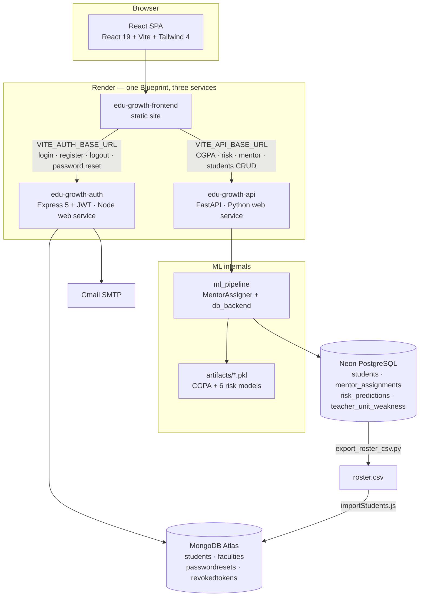

**One-line summary of responsibility:**

| Piece | Owns | Source of truth |
|-------|------|-----------------|
| `frontend/` | UI, charts, session storage (`localStorage`) | — |
| `backend/` | Identity, login, JWT, password reset, logout | **MongoDB** |
| `ML/` | CGPA prediction, risk flags, mentor assignment, student CRUD | **Neon PostgreSQL** |

---

### 1 · Frontend workflow (React SPA)

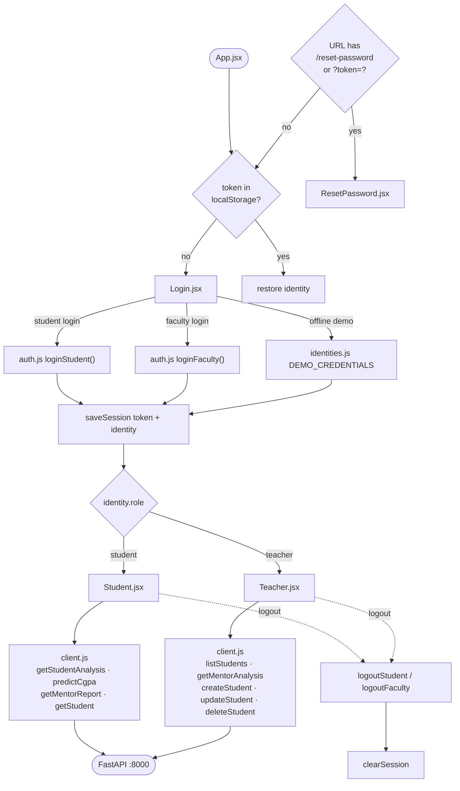

**Pages & navigation**

| File | Role | Tabs / purpose |
|------|------|----------------|
| `App.jsx` | router + session | restores JWT, detects `/reset-password`, picks Student vs Teacher |
| `Login.jsx` | login/register | student & faculty login, register, forgot-password, offline demo fallback |
| `Student.jsx` | student dashboard | 1 Overview · 2 Marks Analytics · 3 Attendance · 4 Risk Alerts · 5 CGPA Predictor · 6 Allocated Mentors · 7 Study Station · 8 My Profile |
| `Teacher.jsx` | faculty dashboard | 1 Class Overview · 2 Student Insights · 3 Assigned & Internals · 4 Mentorship Hub · 5 Student Directory |
| `ResetPassword.jsx` | password reset | consumes `?token=` and posts the new password |
| `CgpaPredictor.jsx` | standalone predictor | calls `POST /api/v1/cgpa/predict` |

**API clients**

| Module | Talks to | Base URL env var |
|--------|----------|------------------|
| `src/api/client.js` | FastAPI analytics | `VITE_API_BASE_URL` (default `http://127.0.0.1:8000`) |
| `src/api/auth.js` | Express auth | `VITE_AUTH_BASE_URL` (default `http://localhost:5001`) |

---

### 2 · Auth backend workflow (Express + MongoDB + JWT)

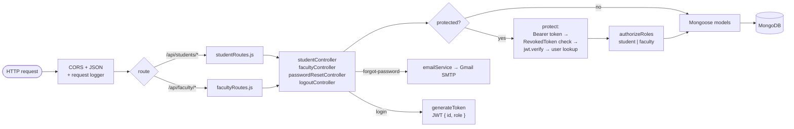

**Student login — how the password is verified**

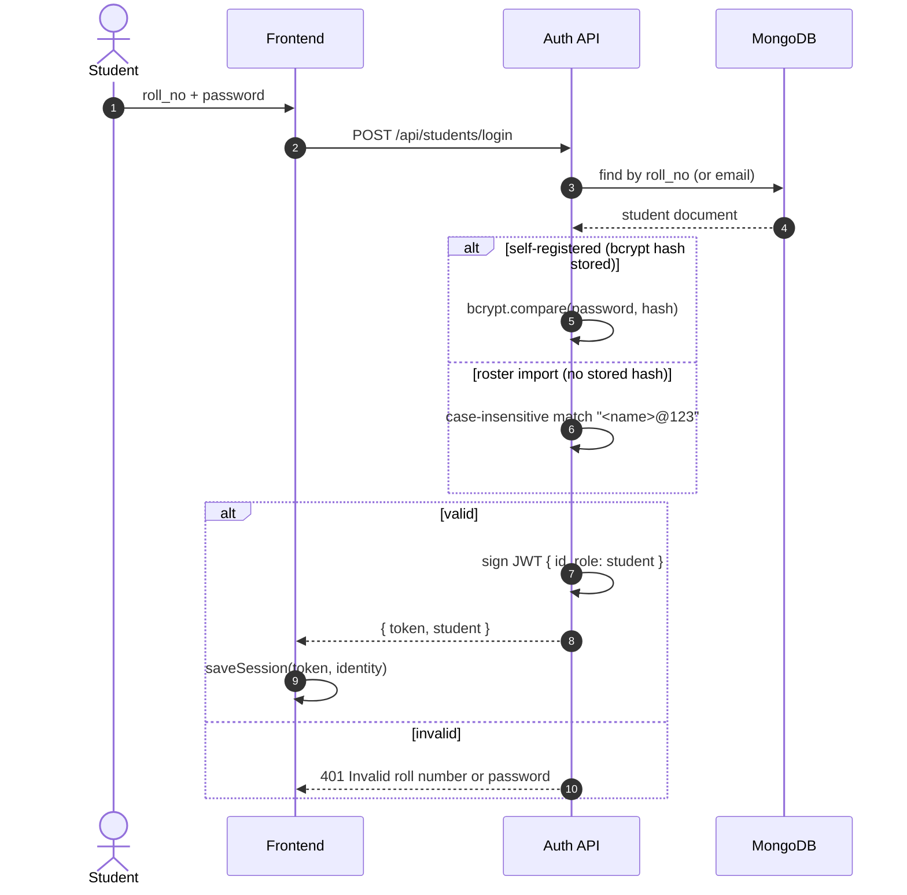

**Password reset + logout**

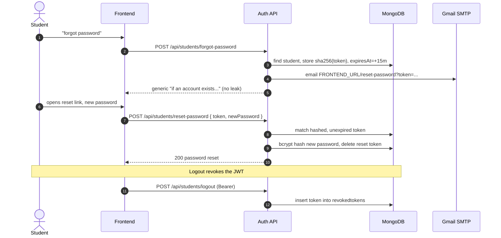

---

### 3 · ML / Analytics API workflow (FastAPI + Neon + models)

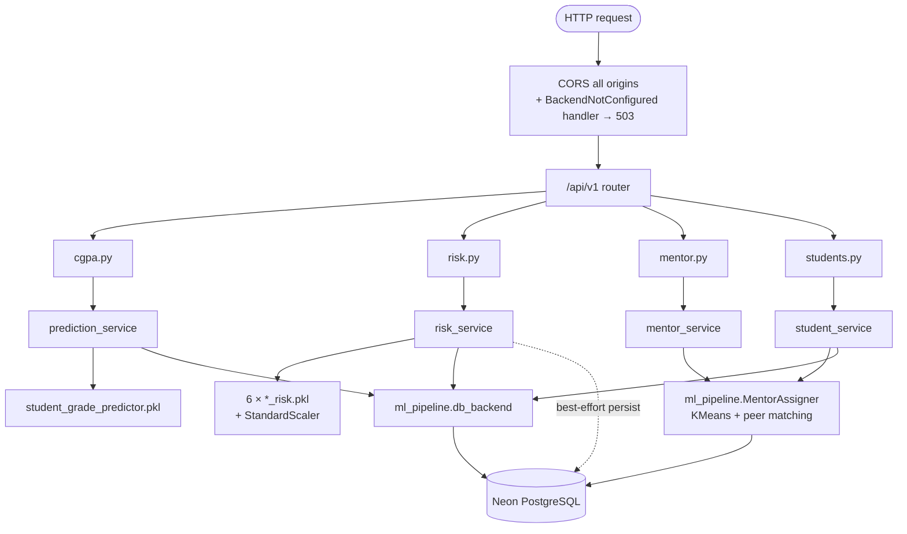

**Student analysis (mentor + CGPA + risk) — the core read flow**

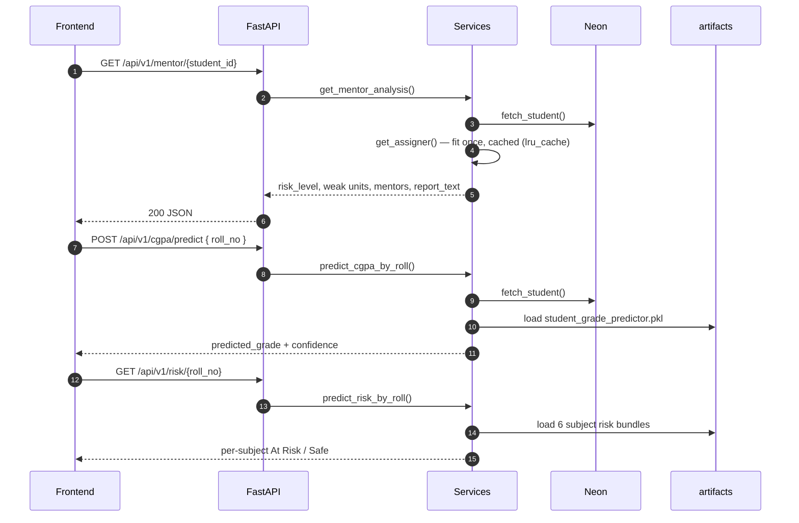

**Add / update a student — mentor assignment runs in the background**

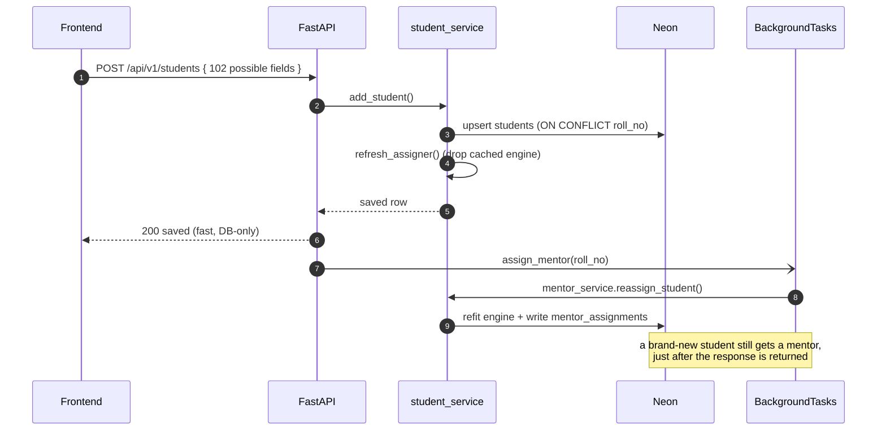

---

### 4 · Mentor engine internals (`ml_pipeline/MentorAssigner`)

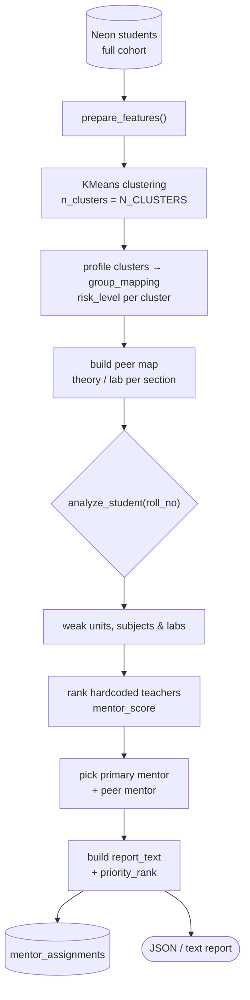

---

### 5 · Data model — both databases

**Neon PostgreSQL** (analytics — created automatically by `db_backend.ensure_schema()`):

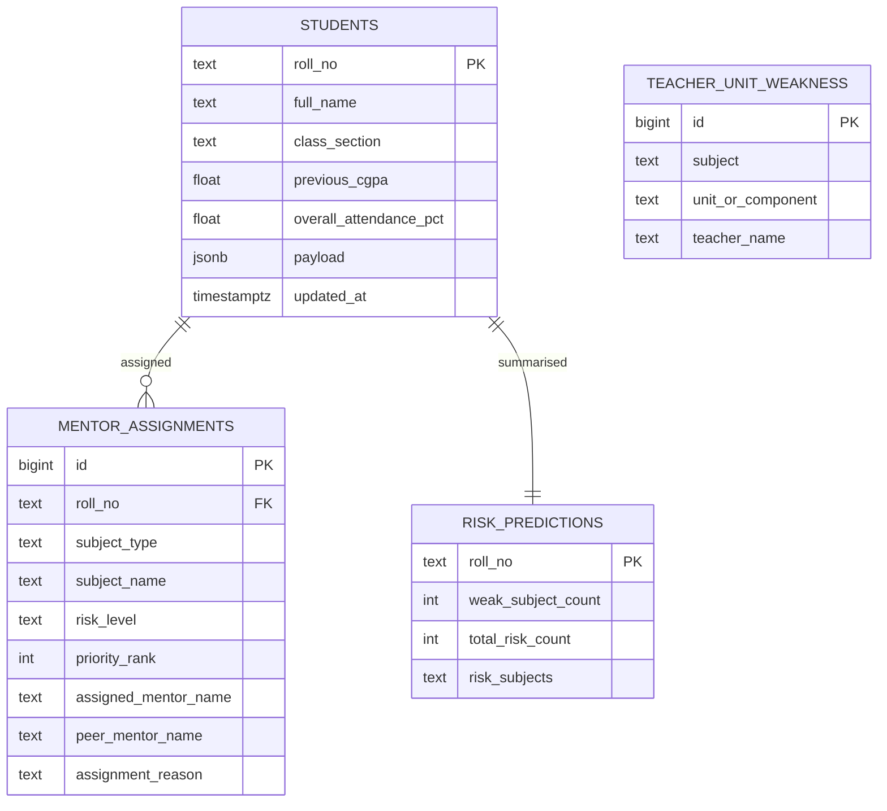

> The 100+ raw academic columns live inside `students.payload` (JSONB); the
> flattened API response merges `payload` back to the top level.

**MongoDB Atlas** (auth — Mongoose collections):

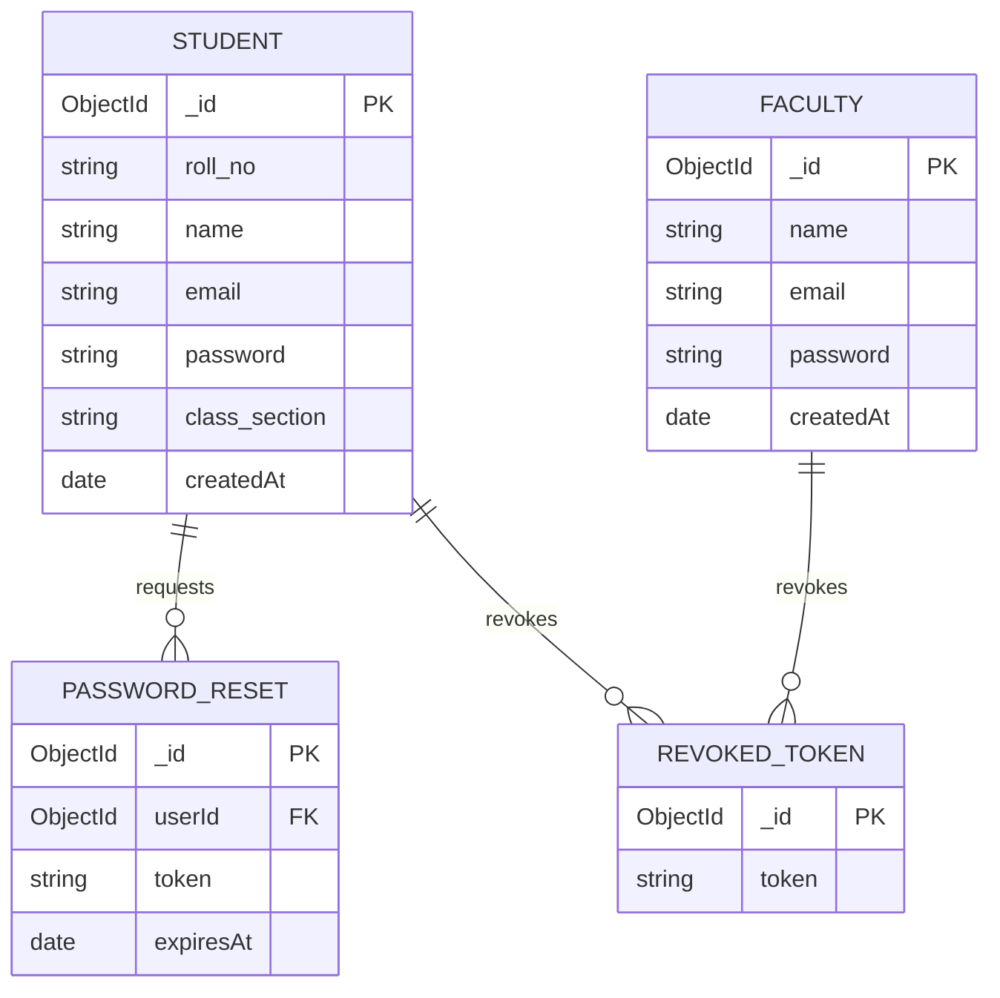

> Mongoose pluralises the collection names: `students`, `faculties`,
> `passwordresets`, `revokedtokens`. `roll_no` and `email` are unique **partial**
> indexes (only on documents that actually have a value).

---

### 6 · Roster sync (Neon → CSV → MongoDB)

Neon is the authoritative roster; MongoDB holds the login accounts. This keeps
the two in step:

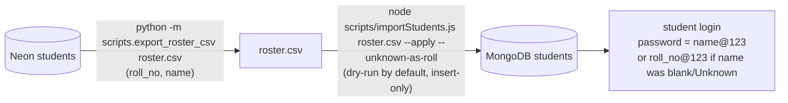

---

### 7 · Deployment topology (Render — one Blueprint)

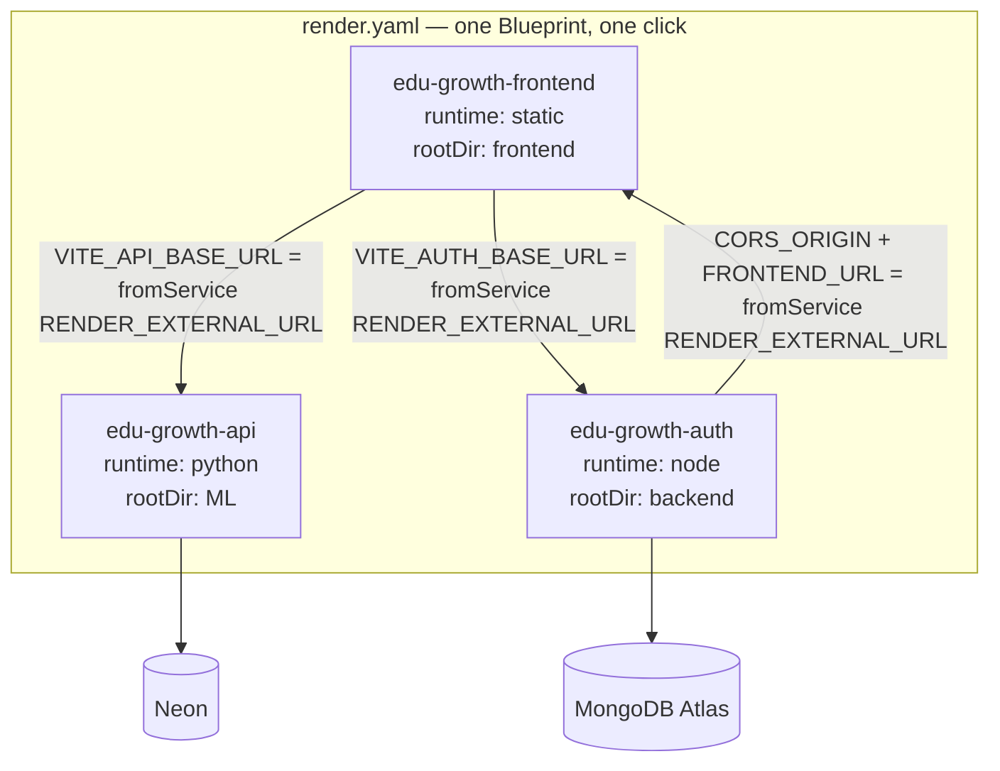

**Public URLs (as long as the names are free):**

| Service | URL |
|---------|-----|
| Frontend | `https://edu-growth-frontend.onrender.com` |
| Auth | `https://edu-growth-auth.onrender.com` |
| ML API | `https://edu-growth-api.onrender.com` · docs at `/docs` · health at `/health` |

---

### 8 · API reference (all endpoints)

**Auth service — Express (`:5001` local)**

| Method | Path | Auth | Purpose |
|--------|------|------|---------|
| GET | `/` | — | health / "Backend is running" |
| POST | `/api/students/register` | — | create a student account |
| POST | `/api/students/login` | — | login → JWT |
| POST | `/api/students/forgot-password` | — | request reset link |
| POST | `/api/students/reset-password` | — | complete reset |
| GET | `/api/students/profile` | Bearer (student) | current student |
| POST | `/api/students/logout` | Bearer (student) | revoke token |
| POST | `/api/faculty/register` | — | create a faculty account |
| POST | `/api/faculty/login` | — | login → JWT |
| GET | `/api/faculty/profile` | Bearer (faculty) | current faculty |
| POST | `/api/faculty/logout` | Bearer (faculty) | revoke token |
| GET | `/api/protected` | Bearer | JWT sanity check |

**Analytics API — FastAPI (`:8000` local)**

| Method | Path | Purpose |
|--------|------|---------|
| GET | `/health` | health check |
| POST | `/api/v1/cgpa/predict` | predict final grade + confidence |
| GET | `/api/v1/risk/{roll_no}` | per-subject risk flags |
| POST | `/api/v1/risk/predict` | same, JSON body |
| GET | `/api/v1/mentor/{student_id}` | full mentor analysis |
| GET | `/api/v1/mentor/{student_id}/report` | printable text report |
| POST | `/api/v1/mentor/analyze` | analysis via JSON body |
| POST | `/api/v1/students` | add / upsert a student (mentor in background) |
| PUT | `/api/v1/students/{roll_no}` | partial update (mentor in background) |
| GET | `/api/v1/students` | list (paged, `limit`/`offset`/`search`) |
| GET | `/api/v1/students/{roll_no}` | one student |
| DELETE | `/api/v1/students/{roll_no}` | delete one student |

## One-click deploy (Render)

[](https://render.com/deploy?repo=https://github.com/cybodexx/edu-growth)

The root [`render.yaml`](render.yaml) Blueprint provisions the **whole project**
in a single sync — the FastAPI analytics API, the Express auth service, and the
React frontend:

| # | Service | Type | Root dir | Public URL |
|---|---------|------|----------|------------|
| 1 | `edu-growth-api` | Python web | `ML/` | `https://edu-growth-api.onrender.com` |
| 2 | `edu-growth-auth` | Node web | `backend/` | `https://edu-growth-auth.onrender.com` |
| 3 | `edu-growth-frontend` | Static site | `frontend/` | `https://edu-growth-frontend.onrender.com` |

> The suffix is added by Render if the name is already taken; check the
> Dashboard for the exact URLs. The ML API also serves OpenAPI docs at
> `https://edu-growth-api.onrender.com/docs` and a health check at `/health`.

### What you provide (Render prompts on the first sync)

| Variable | For | Where to get it |
|----------|-----|-----------------|
| `DATABASE_URL` | ML analytics | Neon dashboard → Connection string (`...?sslmode=require`) |
| `MONGO_URI` | Auth service | MongoDB Atlas → Connect → Drivers (allow `0.0.0.0/0`) |

Everything else is wired automatically:

- **Frontend URLs** — `VITE_API_BASE_URL` and `VITE_AUTH_BASE_URL` are copied
  from the two backends' `RENDER_EXTERNAL_URL` at build time (`fromService`).
- **Auth CORS / reset links** — `CORS_ORIGIN` and `FRONTEND_URL` are copied from
  the frontend's `RENDER_EXTERNAL_URL`.
- **`JWT_SECRET`** — Render generates a strong random value.

### After the first deploy

1. **Check the three URLs** (Dashboard → each service → the `.onrender.com` link;
   ML: open `/health` and `/docs`).
2. **Create the admin faculty account** (once) — from the auth service's Shell tab
   in the Dashboard, or locally against the deployed URL:
   ```bash
   curl -X POST https://edu-growth-auth.onrender.com/api/faculty/register \
     -H "Content-Type: application/json" \
     -d '{"name":"Rajesh Verma","email":"faculty@college.edu","password":"teacher123"}'
   ```
3. **Copy the roster into MongoDB** so students can log in (run locally — see the
   *Roster sync* section above, pointing `MONGO_URI` at the Atlas cluster).
4. **MongoDB Atlas** → Network Access → allow `0.0.0.0/0` (Render IPs are dynamic).

> **Free tier note:** free web services sleep after ~15 min idle and cold-start in
> ~30–60 s (the static frontend does not sleep). The ML mentor engine also re-fits
> on the first request after a write, so the very first mentor call may be slow.

> **If the frontend was built before the backends existed**, its baked-in API URLs
> can be empty (it then falls back to `localhost`). Fix: open the
> `edu-growth-frontend` service → **Manual Deploy → Deploy latest commit** so Vite
> re-runs with the now-populated URLs.
